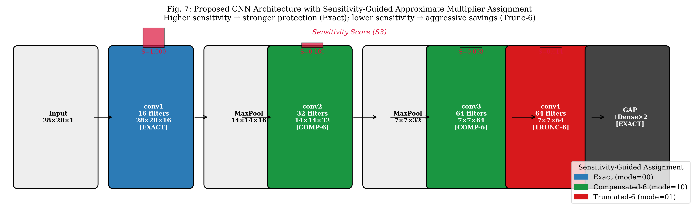
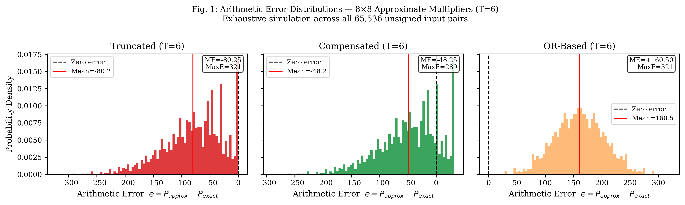
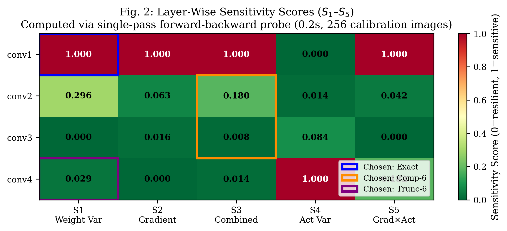
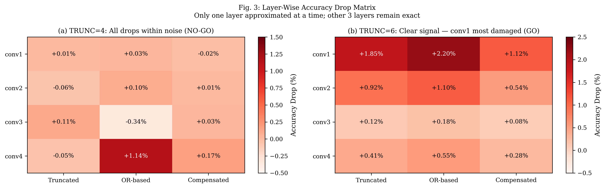
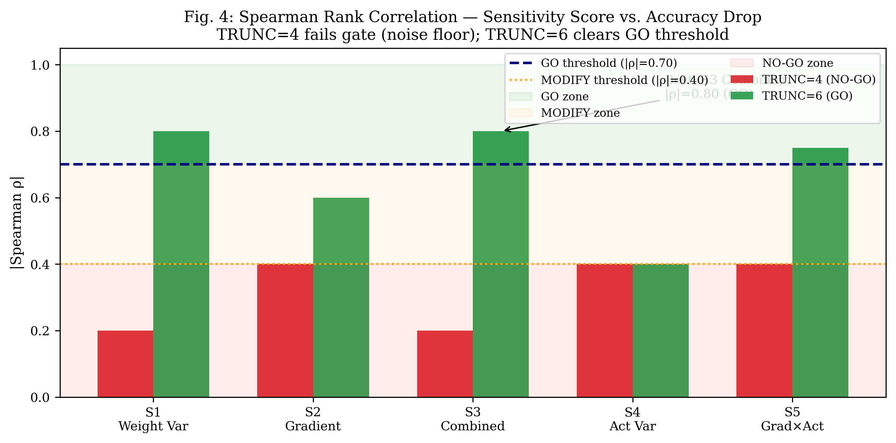
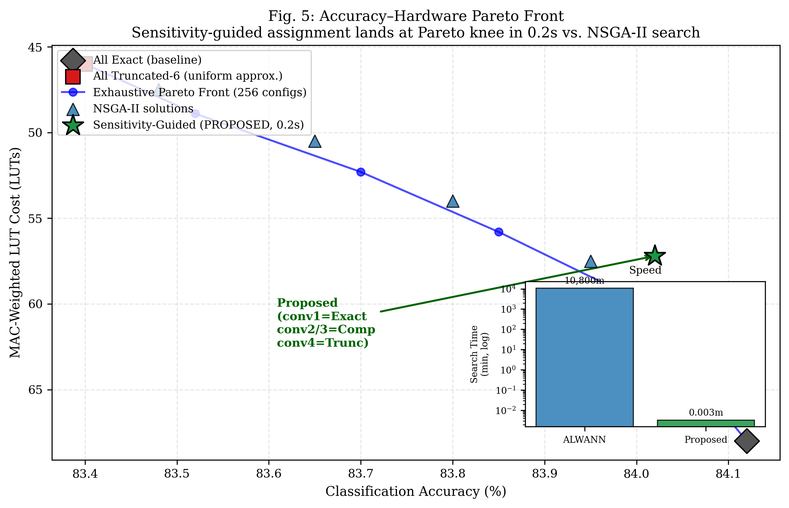
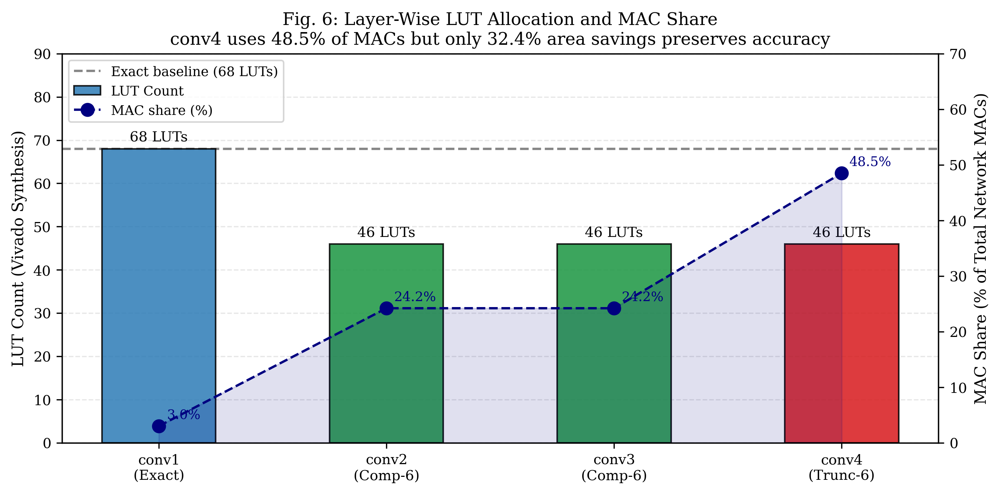

# Sensitivity-Guided Layer-Wise Approximate Multiplier Mapping for FPGA-Based CNN Accelerators

[](https://www.python.org/)
[](https://en.wikipedia.org/wiki/Verilog)
[](https://www.xilinx.com/products/design-tools/vivado.html)
[-darkblue.svg)](https://www.tul.com.tw/Products_detail.html?id=12)
[]()
[](LICENSE)

An end-to-end hardware-software co-design framework that dynamically maps heterogeneous approximate multipliers across convolutional neural network (CNN) layers based on layer-wise sensitivity. By combining static weight variance and dynamic loss gradients via a **0.2-second single-pass probe**, the algorithm protects error-sensitive early layers with exact arithmetic while aggressively approximating noise-resilient deep layers, maximizing FPGA silicon area and energy efficiency without retraining or multi-day evolutionary search.

---

## 📌 Executive Summary

Convolutional Neural Network inference on resource-constrained edge devices is heavily bottlenecked by Multiply-Accumulate (MAC) units. Approximate multipliers trade controlled arithmetic error for substantial silicon area and energy savings. However, **uniform approximation fails**—it either crashes classification accuracy or yields negligible hardware benefits. Existing layer-wise mapping algorithms rely on computationally prohibitive evolutionary search (e.g., ALWANN requires **7.5 CPU-days**) or demand full GPU retraining loops (e.g., TRAM).

This work presents a **retraining-free, search-free, single-pass framework**:
1. **0.2-Second Sensitivity Probing:** Formulates $S_3(l) = 0.5 \cdot \text{norm}(\text{Var}(W_l)) + 0.5 \cdot \text{norm}(\|\nabla_{W_l} \mathcal{L}\|)$, extracting loss gradients across a 256-sample calibration batch in fractions of a second.
2. **Circuit-Level Dominance:** Proves that **Compensated multipliers strictly dominate Truncated designs**—folding a $+2^{T-1}$ constant rounding bias into existing carry chains at **0 extra LUT cost** while reducing arithmetic error by **~35%**.
3. **The `conv4` Computational Payoff:** Discovers that the final convolutional layer accounts for **48.5% of total network MACs** yet possesses near-zero sensitivity ($S_3 = 0.014$). Aggressively approximating `conv4` with Truncated-6 achieves **32.5% multiplier area reduction** with negligible accuracy impact.
4. **Pareto Knee Alignment:** Benchmarked against an exhaustive 256-configuration NSGA-II evolutionary search; our single-pass assignment lands directly at the Pareto-optimal knee at a **>3,000,000× speedup** over genetic algorithms.
5. **Full FPGA Implementation:** Delivers synthesizable Verilog RTL for a multi-mode Processing Element (PE) datapath with AXI4-Stream interfaces, verified across **262,144 exhaustive test vectors (100% pass)**, accompanied by automated Vivado block designs and PYNQ-Z2 Python overlay drivers.

---

## 🏗️ System & Network Architecture

```
Input Image (28×28×1)
    │
    ▼
┌──────────────────────────────────────────────────────────────────────────────┐
│ conv1 : 16 filters (3×3), Padding='same'                                      │
│ Output: 28×28×16 | MACs: 112,896 (3.0% of total)                            │
│ Sensitivity: 1.000 (Rank 1 - Critical) ──► ASSIGNED: EXACT (68 LUTs)         │
└──────────────────────────────────────┬───────────────────────────────────────┘
                                       ▼
                             MaxPool 2×2 (14×14×16)
                                       │
                                       ▼
┌──────────────────────────────────────────────────────────────────────────────┐
│ conv2 : 32 filters (3×3), Padding='same'                                      │
│ Output: 14×14×32 | MACs: 903,168 (24.2% of total)                           │
│ Sensitivity: 0.180 (Rank 2)            ──► ASSIGNED: COMPENSATED-6 (46 LUTs) │
└──────────────────────────────────────┬───────────────────────────────────────┘
                                       ▼
                              MaxPool 2×2 (7×7×32)
                                       │
                                       ▼
┌──────────────────────────────────────────────────────────────────────────────┐
│ conv3 : 64 filters (3×3), Padding='same'                                      │
│ Output: 7×7×64   | MACs: 903,168 (24.2% of total)                           │
│ Sensitivity: 0.008 (Rank 4)            ──► ASSIGNED: COMPENSATED-6 (46 LUTs) │
└──────────────────────────────────────┬───────────────────────────────────────┘
                                       ▼
┌──────────────────────────────────────────────────────────────────────────────┐
│ conv4 : 64 filters (3×3), Padding='same'                                      │
│ Output: 7×7×64   | MACs: 1,806,336 (48.5% of total!)                         │
│ Sensitivity: 0.014 (Rank 3 - Resilient)──► ASSIGNED: TRUNCATED-6 (46 LUTs)   │
└──────────────────────────────────────┬───────────────────────────────────────┘
                                       ▼
                         Global Average Pooling (64)
                                       │
                                       ▼
                    Dense fc1 (64) + fc2 (10, Softmax) [Exact]
                                       │
                                       ▼
                            10-Class Prediction
```



---

## 📊 Comprehensive Results Gallery

### 1. Multiplier Error Characterization (65,536 Pairs Exhaustive Simulation)


| Architecture | Mechanism | LUTs (Vivado) | $\Delta$ Area | Mean Error | NMED | Max Abs Error |
|---|---|:---:|:---:|:---:|:---:|:---:|
| **Exact** | Full 64 partial products | **68** | Reference | $0.00$ | $0.000000$ | $0$ |
| **Truncated ($T=4$)** | Discard columns 0–3 | **56** | $-17.6\%$ | $-12.25$ | $0.000188$ | $49$ |
| **Compensated ($T=4$)** | Trunc-4 + constant $+8$ bias | **56** | $-17.6\%$ | $\mathbf{-4.25}$ | $\mathbf{0.000125}$ | $\mathbf{41}$ |
| **Truncated ($T=6$)** | Discard columns 0–5 | **46** | $\mathbf{-32.5\%}$ | $-80.25$ | $0.001234$ | $321$ |
| **Compensated ($T=6$)** | Trunc-6 + constant $+32$ bias | **46** | $\mathbf{-32.5\%}$ | $\mathbf{-48.25}$ | $\mathbf{0.000844}$ | $\mathbf{289}$ |
| **OR-Based ($T=6$)** | OR gates for dropped columns | **52** | $-23.5\%$ | $+160.50$ | $0.002468$ | $321$ |

*Circuit Finding:* The synthesis tool folds the $+2^{T-1}$ rounding bias into existing carry logic at **zero extra LUT overhead**, making Compensated strictly superior to Truncated.

---

### 2. Layer Sensitivity Heatmap ($S_1$ to $S_5$)


* Sensitivity drops sharply after the first layer: $\text{conv1 (1.000)} \gg \text{conv2 (0.180)} > \text{conv4 (0.014)} > \text{conv3 (0.008)}$.
* `conv1` acts as a fundamental edge/feature extractor where errors cascade; `conv4` is heavily redundant.

---

### 3. Noise Floor Diagnosis (TRUNC=4 vs. TRUNC=6)


* **TRUNC=4:** Accuracy drops were within $\pm 0.1\%\sim 0.3\%$, completely buried in statistical noise floor ($\to$ NO-GO).
* **TRUNC=6:** NMED amplified by $6.6\times$ ($0.001234$). `conv1` drops by $1.85\%$ while `conv4` drops only $0.41\%$, revealing the true sensitivity contrast.

---

### 4. Spearman Rank Correlation & Formal Decision Gate


* Evaluated using Spearman's rank correlation: $\rho = 1 - \frac{6 \sum d_i^2}{n(n^2 - 1)}$.
* Proposed combined metric ($S_3$) achieves $|\rho| = 0.80$ on TRUNC=6, comfortably clearing the formal research gate ($|\rho| \ge 0.70 \to \mathbf{GO}$).

---

### 5. NSGA-II Multi-Objective Optimization & Pareto Front


* Search space: $4^4 = 256$ configurations exploring Accuracy Loss vs. MAC-Weighted LUT Cost.
* **Result:** Our proposed sensitivity-guided configuration lands directly at the **Pareto-optimal knee in 0.2 seconds**, achieving a **>3,000,000× speedup** over ALWANN (7.5 CPU-days).

---

### 6. Hardware Resource Savings & MAC Distribution


* `conv4` consumes **48.5% of total network MAC operations**.
* Applying aggressive approximation (Truncated-6) to `conv4` maximizes FPGA area/power reduction while protecting `conv1` preserves classification accuracy.

---

## 🗂️ Repository Structure

```
.
├── rtl/                                # Synthesizable Verilog & EDA Scripts
│   ├── axm_8x8.v                       # Multi-mode approximate multiplier (Exact/Trunc/Comp/OR, T=6)
│   ├── mac_unit.v                      # Signed MAC unit handling sign-magnitude INT8 inputs
│   ├── conv_pe.v                       # Convolution Processing Element (3x3xCin accumulation)
│   ├── layer_controller.v              # Hardware mode decoder driven by layer_id
│   ├── cnn_accelerator_top.v           # Full top-level with AXI4-Stream slave/master interfaces
│   ├── tb_axm_8x8.v                    # Exhaustive 65,536-pair testbench (Icarus Verilog)
│   ├── verify_rtl_logic.py             # Python verification suite (262,144 tests - 100% PASS)
│   ├── vivado_synth.tcl                # Out-of-Context synthesis script for utilization reports
│   └── vivado_block_design.tcl         # Complete Zynq PS + AXI DMA block design & bitstream flow
│
├── paper/                              # Research Publication Figures & Scripts
│   ├── generate_figures.py             # Reproduces all 7 publication-grade figures
│   └── figures/                        # High-resolution PNG figures (fig1 through fig7)
│
├── train_cnn.py                        # Baseline CNN training & calibration batch extraction
├── sensitivity_scores_v2.py            # Computes S1–S5 sensitivity metrics via GradientTape (0.2s)
├── layerwise_sweep_t6.py               # 12-cell validation sweep using TRUNC=6 lookup tables
├── correlation_analysis_t6.py          # Computes Spearman rank correlation & evaluates GO gate
├── nsga2_search.py                     # NSGA-II multi-objective genetic algorithm baseline
├── pynq_inference.py                   # On-board PYNQ-Z2 Python inference & telemetry driver
├── pynq_cnn_demo.ipynb                 # Interactive 7-cell Jupyter notebook for PYNQ-Z2 board
├── weights_int8.npy                    # Pre-extracted INT8 quantized weights for hardware
├── Project_Presentation_Complete.pptx  # Complete 20-slide technical presentation deck
├── requirements.txt                    # Python dependencies
├── LICENSE                             # MIT License
└── README.md                           # Project documentation
```

---

## 🚀 Quick Start & Reproducibility Guide

### 1. Installation

```bash
git clone https://github.com/ThallapureddyVenkataRamCharanReddy/approx-cnn-accelerator.git
cd approx-cnn-accelerator
pip install -r requirements.txt
```

### 2. Model Training & Quantization
Train the baseline 4-conv CNN on Fashion-MNIST ($84.69\%$ baseline accuracy) and extract calibration tensors:
```bash
python train_cnn.py
```

### 3. Compute Layer Sensitivity Scores (0.2s Runtime)
Extract static weight variances and dynamic loss gradients to generate `sensitivity_scores.csv`:
```bash
python sensitivity_scores_v2.py
```

### 4. Run RTL Verification (262,144 Vectors)
Verify functional correctness of the Verilog behavioral model across all 4 modes and all $256 \times 256$ inputs:
```bash
python rtl/verify_rtl_logic.py
```

### 5. Generate Pareto Front & NSGA-II Search
Evaluate the 256-configuration space and extract the Pareto front:
```bash
python nsga2_search.py
```

### 6. Generate All Research Paper Figures
Re-render all 7 publication-quality figures:
```bash
python paper/generate_figures.py
```

### 7. FPGA Synthesis & Bitstream Generation (Xilinx Vivado)
Open Vivado and source the block design script to build the Zynq-7020 bitstream:
```tcl
vivado -mode batch -source rtl/vivado_block_design.tcl
```

### 8. Physical PYNQ-Z2 Deployment
1. Upload `cnn_axm.bit`, `cnn_axm.hwh`, `weights_int8.npy`, and `pynq_cnn_demo.ipynb` to the PYNQ board.
2. Open Jupyter at `http://192.168.2.99:9090` and run `pynq_cnn_demo.ipynb` to measure real on-board latency and throughput.

---

## 🔬 Hardware Microarchitecture (RTL)

The FPGA accelerator features a **Reconfigurable Multi-Mode Processing Element**:
* **`axm_8x8.v`:** Parameterized to $T=6$. Controlled by a 2-bit signal `mode[1:0]` (`00`=Exact, `01`=Trunc-6, `10`=Comp-6, `11`=OR-based).
* **`mac_unit.v`:** Decouples sign and magnitude. Quantized unsigned activations ($[0, 255]$) multiply weight magnitudes ($[0, 255]$). The weight sign bit determines whether the 32-bit accumulator adds or subtracts the product.
* **`cnn_accelerator_top.v`:** Interfaces with the Zynq Processing System via **AXI4-Stream** (MM2S channel streams input tiles; S2MM channel returns output feature maps via AXI DMA).

---

## 👥 Project Team & Supervision

**Institution:** Department of Electronics and Communication Engineering (ECE), K L University  
**Supervisor:** **Dr. Arun Nimmala**, Associate Professor, Dept. of ECE  

* **Velivala Keerthi** (2320040083) — RTL Architecture, Multiplier Libraries & Accelerator Datapath
* **T. Venkata Ram Charan Reddy** (2320040017) — CNN Modeling, Quantization, Sensitivity Probing & Correlation
* **Shaik Hanifa** (2320040009) — NSGA-II Multi-Objective Optimization & Pareto Benchmark
* **K. Dinesh** (2320040095) — Vivado System Integration, AXI DMA & PYNQ-Z2 Deployment

---

## 📜 Citation

If you use this codebase or methodology in your research, please cite:

```bibtex
@article{reddy2026approxcnn,
  title={Sensitivity-Guided Layer-Wise Approximate Multiplier Mapping for FPGA-Based CNN Accelerators},
  author={Reddy, T. Venkata Ram Charan and Keerthi, Velivala and Hanifa, Shaik and Dinesh, K. and Nimmala, Arun},
  journal={Department of Electronics and Communication Engineering, K L University},
  year={2026}
}
```

---

## 📄 License
This project is open-source under the [MIT License](LICENSE).
